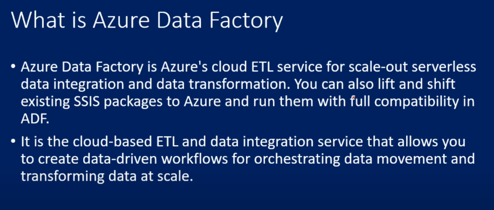
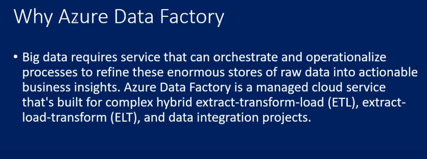

Azure Data Factory is an Azure Service for ETL (Extract, Transform and Load) operations.

## Source

Based on my Notion lesson page: [1. Introduction to Azure Data Factory](https://app.notion.com/p/e0a87b604293438da399464901d7885e).
