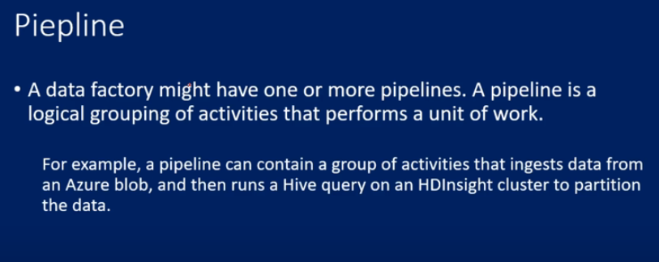
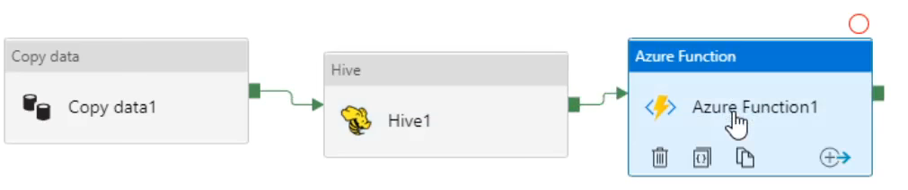
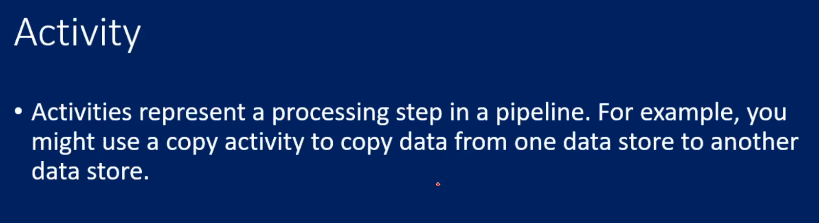
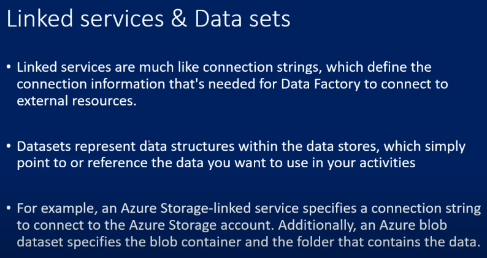
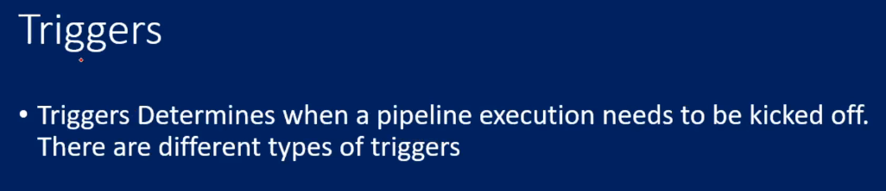

Some of the Top Level Concepts that we need to understand when working with Azure Data Factory are: -

1. Pipeline

   

   

2. Activity

   

3. Datasets an Linked Services

   

4. Triggers

   

## Source

Based on my Notion lesson page: [2. Top Level Concepts in Azure Data Factory](https://app.notion.com/p/5585d2784637420d91b751caa79285e0).
