## Reference

[Bookmark from the original Notion lesson](https://app.notion.com/p/0e9b4e7280954dc3a2a94626a4cf4e50#ef1bac8dc93d4c21b9ffd203038f9935)

Overview: Want to copy a file from one folder to another folder using copy activity in ADF.

1. Create Storage Account and a Container

   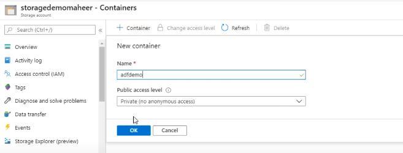

2. Create an Input Folder and place a file that we want to copy.

   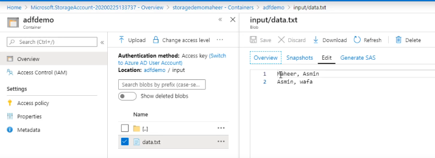

3. Create a Data Factory

   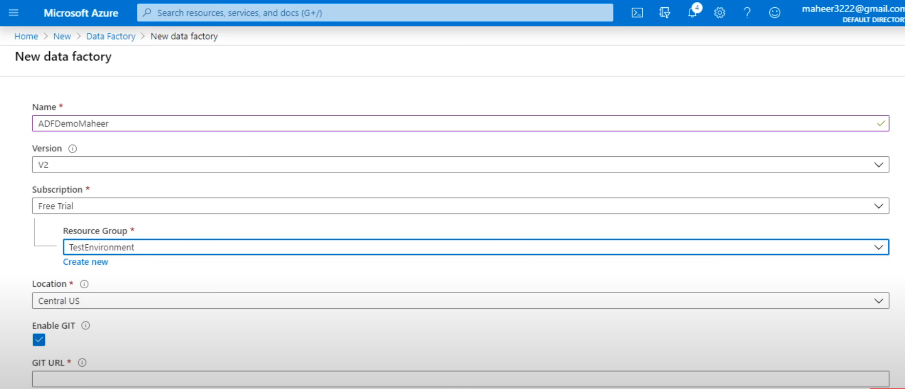

4. Go to ADF and goto Author and Monitor

   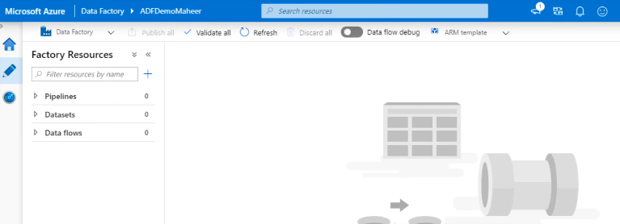

5. Create a Linked Service: Since for our demo, our ADF needs to interact with an external resource which in our case is the storage account we have to create a linked service.

   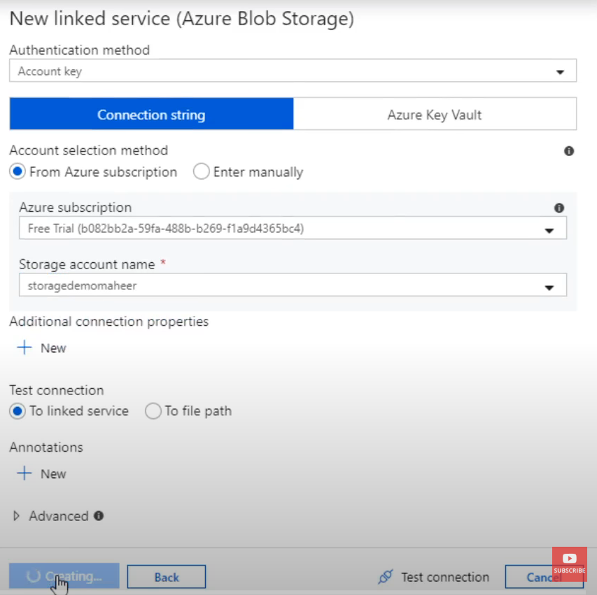

6. Create a Dataset for source and sink

   1. Source Dataset

      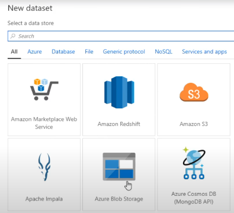

      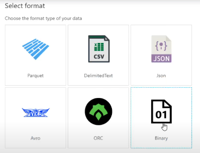

      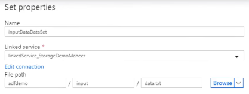

   2. Sink Dataset

      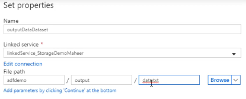

7. Create a Pipeline

   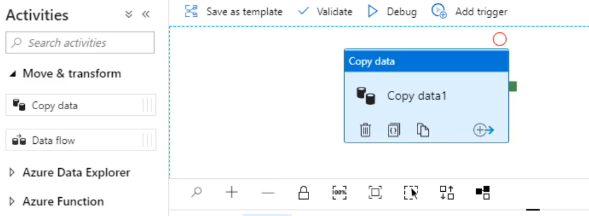

   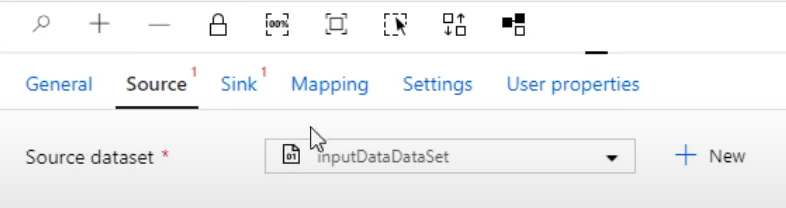

   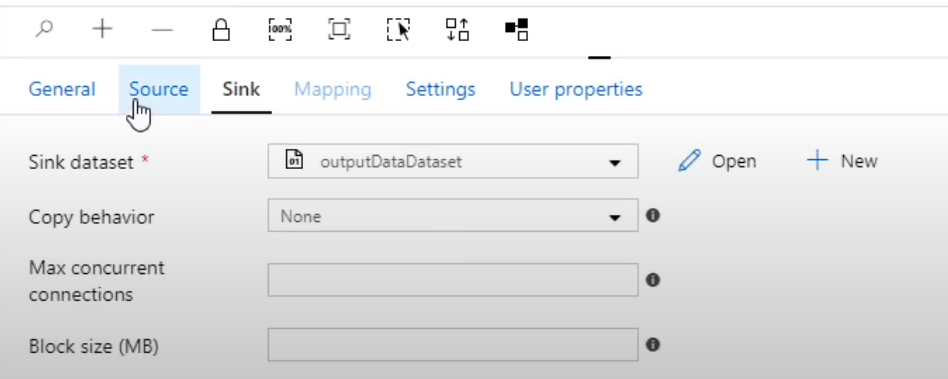

8. Validate your pipeline. Incase we forget to configure anything in our pipeline then it will notify us.

9. Publish our pipeline. Once we publish, all the pipelines, linked services, datasets and triggers will be published in our ADF.

10. Incase we just want to check if our pipeline is running as intended for debugging purpose before publishing we can use the `Debug` mode.

## Source

Based on my Notion lesson page: [3. Create your First Azure Data Factory](https://app.notion.com/p/0e9b4e7280954dc3a2a94626a4cf4e50).
