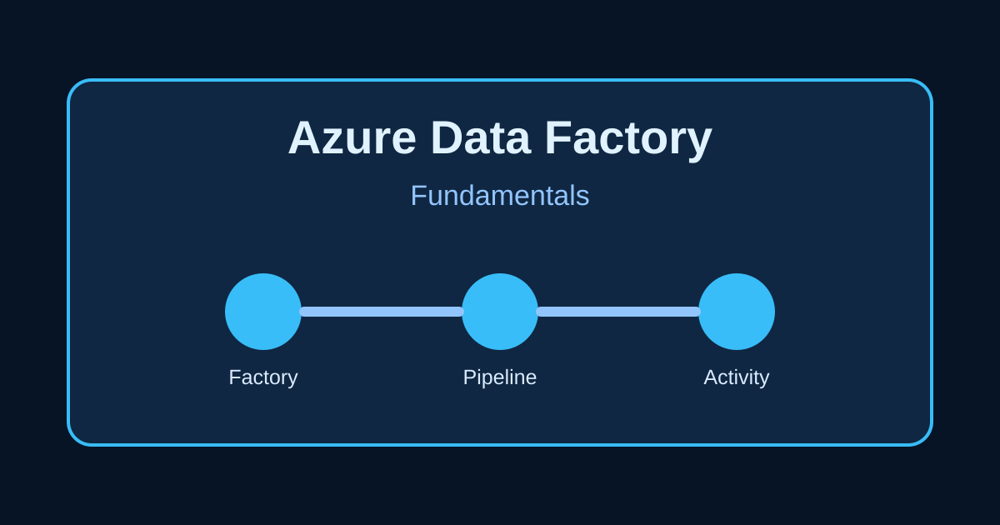

Inline Dataset in ADF covers the shape and location of data used by activities. Datasets sit between linked services and activities, making pipelines reusable across folders, files, tables, and formats.

This post is part of my Azure Data Factory tutorial notes. The goal is to turn the lesson into a practical blog reference: what the feature does, where it fits in an ADF project, what to configure, and what to check before relying on it.

_Azure Data Factory fundamentals_

## Where This Fits

Azure Data Factory is an orchestration and data integration service. A typical ADF solution uses linked services for connections, datasets for data shape and location, pipelines for orchestration, activities for work, triggers for scheduling or events, and monitoring for operational visibility.

**Inline Dataset in ADF** fits into that model as a focused building block. It should be understood not only as a screen in the Azure portal, but as a design decision inside the larger pipeline lifecycle.

## Key Ideas

- Model file paths, table names, schemas, and formats explicitly.
- Use parameters for dates, folders, file names, and table names.
- Keep dataset definitions reusable.
- Confirm format settings before starting large copy jobs.

## Practical Walkthrough

Start with a small factory or development environment. Keep the first version narrow: one source, one destination, one activity chain, and a clear success condition. This makes the behavior of Inline Dataset in ADF easier to see before it is hidden inside a larger production workflow.

Create a small pipeline that uses Inline Dataset in ADF, run it manually, inspect the activity output, and record the exact settings that made the run successful.

After the first run succeeds, inspect the run details. ADF usually gives useful output such as status, duration, input settings, output JSON, error messages, and integration runtime information. That output is often the fastest way to understand whether the feature is configured correctly.

## Design Notes

ADF projects become hard to maintain when every value is typed directly into every activity. Use parameters for values that change, keep naming consistent, and avoid duplicating connection information. For production work, separate environments, avoid hard-coded secrets, and keep a clear path from development to deployment.

When this feature interacts with files or external systems, also think about retry behavior, partial failure, idempotency, and cleanup. A pipeline that works once in a demo can still fail in production if reruns create duplicate files, overwrite the wrong folder, or reuse stale activity output.

## Validation Checklist

- The pipeline or data flow has a clear purpose and readable activity names.
- Connections, datasets, and parameters are tested with realistic values.
- Monitoring output shows the expected rows, files, branches, or status.
- Failure behavior is understood before the workflow is scheduled.
- Secrets and environment-specific values are not hard-coded.

## Source

Based on my Notion lesson page: [87. Inline Dataset in ADF](https://app.notion.com/p/2aaa1433128d4265b83b4d60b4ddc7f8).
