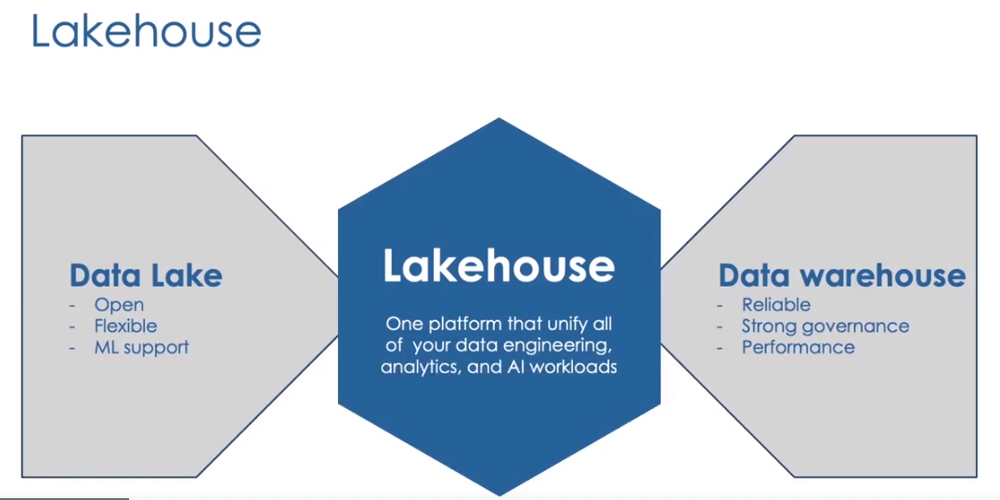

Databricks is a multi-cloud data and AI platform built around Apache Spark. It provides a common workspace for data engineering, analytics, business intelligence, streaming, machine learning, and governance while retaining data in cloud object storage.

This first module establishes the architecture and working environment used throughout the rest of the Databricks series.


_The lakehouse combines the openness of a data lake with the management features of a data warehouse_

## What Is a Lakehouse?

A data lake can store structured, semi-structured, and unstructured data at large scale. It is flexible and inexpensive, but files alone do not guarantee transactions, schema quality, governance, or fast analytics.

A data warehouse offers reliable tables, controlled schemas, and strong SQL performance, but is less natural for raw files, streaming data, data science, and machine learning.

The **lakehouse** combines these ideas:

- Open and flexible cloud storage
- Reliable tables and ACID transactions
- Batch and streaming processing
- SQL analytics and dashboards
- Data science and machine learning
- Centralized security, discovery, and lineage

Databricks implements the lakehouse with Apache Spark, Delta Lake, Databricks SQL, declarative pipelines, Workflows, and Unity Catalog.

## Databricks Is Multi-Cloud

Databricks is available on Amazon Web Services, Microsoft Azure, and Google Cloud. The core platform concepts are similar, while networking, identity, virtual-machine types, and storage services vary by provider.

The cloud provider supplies:

- Virtual machines or serverless infrastructure
- Object storage
- Networking
- Identity integrations
- Regional infrastructure

Databricks supplies the runtime, workspace, orchestration, SQL, governance, and management experience placed over that infrastructure.

## The Three Platform Layers

The original notes organize the platform into three layers:

| Layer | Purpose |
|---|---|
| Cloud service | Infrastructure supplied by AWS, Azure, or Google Cloud |
| Databricks Runtime | Spark, Delta Lake, system libraries, and optimized engines |
| Workspace | Notebooks, compute, jobs, pipelines, SQL, dashboards, and collaboration |

This separation is useful because compute can be replaced without losing data. Durable business data should remain in governed cloud storage rather than on the local disk of a temporary machine.

## Control Plane and Compute Plane

Databricks separates platform management from workload execution.

The **control plane** provides the workspace UI and management services. It coordinates notebooks, jobs, compute configuration, and other workspace resources.

The **compute plane** is where data processing runs. Depending on the cloud and deployment model, this may use classic compute in the customer's cloud account or Databricks-managed serverless compute.

The exact architecture differs by cloud and workspace configuration, so production security reviews should use the documentation for the deployed model rather than assuming every workspace uses the same topology.

## Apache Spark Architecture

Apache Spark distributes processing across machines.

### Driver

The driver:

- Interprets the application
- Builds execution plans
- Divides work into stages and tasks
- Coordinates workers
- Tracks job progress

### Workers

Worker nodes execute tasks against partitions of data. Increasing workers can improve parallelism when the workload and data are large enough to benefit.

### Single-Node Compute

A single-node configuration has no separate workers. Spark runs locally on the driver. It is useful for small labs, lightweight development, and workloads that do not need distributed processing.

Adding workers does not automatically improve every workload. Small datasets can become slower when orchestration and shuffle overhead exceed the benefit of parallel execution.

## Databricks Runtime

Databricks Runtime is the software environment installed on compute. A runtime version determines:

- Apache Spark version
- Delta Lake functionality
- Python and Scala versions
- Bundled libraries
- Security and maintenance support

Long-term support runtimes are useful when stability matters. Newer runtimes may provide performance improvements and newer APIs, but shared production workloads should be tested before upgrading.

> The runtime version shown in an older screenshot is historical. Select a currently supported runtime that is compatible with the workload.
{: .prompt-warning }

## Photon

Photon is Databricks' vectorized query engine. It is implemented in native code and accelerates supported SQL and DataFrame operations.

Photon is especially relevant for:

- SQL analytics
- Delta Lake scans
- Joins and aggregations
- ETL transformations

It does not require rewriting ordinary SQL. The optimizer decides which supported operations can run through Photon.

## The Databricks Workspace

The workspace is the primary collaboration environment. It includes:

- Workspace folders
- Notebooks
- Git folders
- Compute
- Workflows and jobs
- Declarative pipelines
- Catalog Explorer
- SQL warehouses
- Queries and dashboards

Workspace permissions should be managed deliberately. A notebook is code, while a table is data; access to one should not automatically imply unrestricted access to the other.

## Notebooks and Languages

Databricks notebooks support SQL, Python, Scala, and R. A notebook has a default language, but magic commands can switch languages for an individual cell:

```text
%sql
SELECT current_catalog(), current_schema();
```

```text
%python
df = spark.table("main.sales.orders")
display(df)
```

```text
%fs
ls /Volumes/main/training/raw
```

Variables do not automatically move between different language interpreters. Tables and temporary views are a reliable way to exchange tabular results between SQL and Python.

## DBFS and Durable Storage

DBFS provides file-system-style access within Databricks. Historically, DBFS root and mounts were common in training material.

For modern production designs, prefer:

- Unity Catalog managed tables
- External locations
- Unity Catalog volumes
- Direct governed access to cloud storage

DBFS is an abstraction, not a reason to treat cluster-local storage as durable. Important files should live in persistent, governed storage.

## Creating Compute

When creating all-purpose compute, review each setting rather than accepting every default.

### Compute Name and Policy

A clear name identifies the team and purpose. Compute policies constrain node types, runtime versions, scaling limits, access modes, and auto-termination settings.

### Access Mode

Access mode determines workload isolation, supported languages, and the security model. Choose the mode required by Unity Catalog and the intended users.

### Runtime and Node Types

Select a supported runtime and node type appropriate for memory, CPU, local storage, and workload characteristics.

### Fixed Workers or Autoscaling

Fixed-size compute uses a constant number of workers. Autoscaling allows Databricks to add or remove workers within configured bounds.

Autoscaling helps variable workloads, but a poorly chosen range can still be expensive or underpowered.

### Auto Termination

Auto termination stops idle interactive compute after a configured period. It is one of the simplest cost controls for development environments.

## DBUs and Cost

A Databricks Unit, or DBU, represents processing capability used in Databricks pricing. Total workload cost can include:

- Databricks DBUs
- Cloud virtual machines
- Serverless usage
- Storage
- Network transfer

Cost is influenced by runtime, node type, number of workers, execution time, and workload type.

Useful controls include:

- Auto termination
- Job compute for scheduled workloads
- Compute policies
- Sensible autoscaling bounds
- Cluster pools where classic startup time matters
- Serverless compute where appropriate

## Starting, Editing, and Terminating Compute

The Compute page shows whether a resource is running, pending, restarting, or terminated. A terminated interactive resource can normally be restarted with its configuration preserved.

Editing settings such as runtime, node type, or access mode may require a restart.

Terminate unused compute rather than deleting it when the configuration will be reused. Delete it when the resource and its permissions are no longer needed.

## Event Log and Driver Logs

The compute detail page provides operational information:

- The **event log** records lifecycle events such as creation, startup, resize, restart, failure, and termination.
- **Driver logs** contain output from the Spark driver and help diagnose library, startup, and application failures.
- The Spark UI provides stages, tasks, executors, SQL plans, storage, and streaming information.

When a notebook is slow, inspect the Spark UI and query profile before assuming the solution is simply a larger cluster.

## Practical Setup Checklist

1. Create or open a workspace.
2. Confirm access to the required catalog and storage.
3. Create development compute with a supported runtime.
4. Enable auto termination.
5. Create a notebook.
6. Attach it to compute.
7. Run a SQL and Python cell.
8. Inspect the compute event log.
9. Terminate compute after the lab.

## Key Takeaways

- Databricks is a lakehouse platform, not only hosted Spark.
- The workspace manages code and workflows; cloud storage keeps durable data.
- The driver coordinates work and workers process partitions.
- Databricks Runtime packages Spark, Delta Lake, and libraries.
- Photon accelerates supported SQL and DataFrame workloads.
- Compute configuration affects security, performance, and cost.
- Modern projects should prefer Unity Catalog-governed storage over legacy DBFS patterns.

## Source Notes

Based on my complete Notion module: [1. Introduction](https://app.notion.com/p/1a76b346998b42c0a5d8593cc76f14bb).

