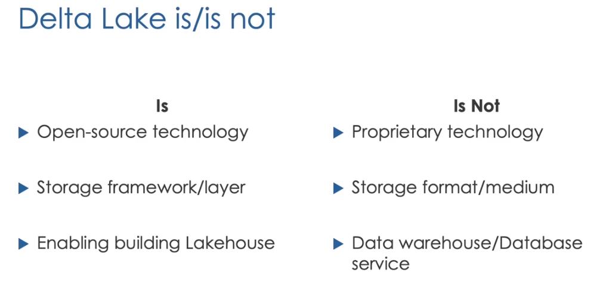

Delta Lake is the open storage framework that gives lakehouse tables reliable transactions, schema controls, version history, and data-management operations while keeping data in cloud object storage.

It is not a separate database service or storage medium. A Delta table consists of data files, normally Parquet, together with a transaction log.


_Delta Lake adds reliable table semantics to files in a data lake_

## Why Plain Data Lakes Need Delta Lake

Without a transaction layer, readers may encounter partially written files, concurrent writers may conflict, schema changes can appear unexpectedly, and update operations require complex file management.

Delta Lake adds:

- ACID transactions
- Consistent snapshots
- Schema enforcement
- Updates, deletes, and upserts
- Table history and time travel
- Batch and streaming compatibility
- Scalable metadata

## The Transaction Log

Every Delta table has a `_delta_log` directory. Each committed operation records actions such as:

- Add a data file
- Remove a data file
- Change table metadata
- Change protocol requirements
- Record transaction information

A reader first evaluates the log to determine which files form the requested table version.

If a writer creates a file but fails before committing the transaction, that file is not included in the valid table snapshot. Readers therefore avoid partially committed data.

## ACID Transactions

- **Atomicity** means a transaction is fully committed or not committed.
- **Consistency** means committed data follows table rules.
- **Isolation** means concurrent operations work against valid snapshots.
- **Durability** means committed changes persist in cloud storage.

Delta uses optimistic concurrency control. Writers validate whether another transaction changed the data they read before committing.

## Creating a Delta Table

```sql
CREATE TABLE employees (
  id INT,
  name STRING,
  salary DOUBLE
);

INSERT INTO employees VALUES
  (1, 'Adam', 3500.0),
  (2, 'Sarah', 4020.5),
  (3, 'John', 2999.3),
  (4, 'Thomas', 4000.3),
  (5, 'Anna', 2500.0),
  (6, 'Kim', 6200.3);
```

Inspect it with:

```sql
DESCRIBE DETAIL employees;
DESCRIBE EXTENDED employees;
SHOW CREATE TABLE employees;
```

`DESCRIBE DETAIL` returns the table format, location, creation time, file count, size, partition columns, and properties.

## Inspecting Table Files

The location returned by `DESCRIBE DETAIL` points to the table directory. A managed Delta table contains Parquet data files and `_delta_log`.

The transaction log is the source of truth. Directly modifying or deleting files behind a Delta table bypasses transaction guarantees and can corrupt the table state.

## Managed Tables

A managed table delegates metadata and data lifecycle management to the catalog:

```sql
CREATE TABLE managed_employees (
  id INT,
  name STRING
);
```

When the table is dropped, its managed data is normally removed according to the catalog's behavior.

## External Tables

An external table registers data in a separately managed location:

```sql
CREATE TABLE external_employees (
  id INT,
  name STRING
)
USING DELTA
LOCATION '/Volumes/main/hr/external/employees';
```

Dropping the table removes the catalog entry but leaves the data at the external location.

Managed versus external describes data lifecycle, not whether the table has Delta capabilities. Both can be Delta tables.

## Table Updates

```sql
UPDATE employees
SET salary = salary + 500
WHERE name = 'Anna';

DELETE FROM employees
WHERE id = 3;
```

Delta does not update a Parquet record in place. It writes new files and records the old files as removed in the transaction log.

## Table History

```sql
DESCRIBE HISTORY employees;
```

History includes version, timestamp, operation, user, notebook or job information, operation parameters, and metrics where available.

Use history for auditing and troubleshooting, but remember that table history does not guarantee old data files remain forever.

## Time Travel

Query an older version:

```sql
SELECT * FROM employees VERSION AS OF 1;
```

Or query by timestamp:

```sql
SELECT *
FROM employees
TIMESTAMP AS OF '2025-10-20T09:00:00Z';
```

Time travel is useful for:

- Auditing changes
- Reproducing a report
- Comparing versions
- Recovering from an incorrect write

## Restoring a Table

```sql
RESTORE TABLE employees TO VERSION AS OF 1;
```

`RESTORE` does not erase later history. It creates a new table version whose contents match the selected older state.

## Schema Enforcement

Delta validates writes against the table schema. A write with incompatible column types or unexpected columns fails unless an intentional schema-evolution mechanism is used.

Add a column explicitly:

```sql
ALTER TABLE employees
ADD COLUMNS (department STRING);
```

Schema enforcement protects the data contract. Automatic evolution should be enabled only when unexpected source changes have a defined handling policy.

## Constraints

Delta tables can declare constraints:

```sql
ALTER TABLE employees
ADD CONSTRAINT valid_salary CHECK (salary >= 0);
```

Constraints improve table quality but do not replace pipeline-level validation and quarantine strategies.

## File Compaction with OPTIMIZE

Frequent small writes create many small files. This increases file-listing and task-scheduling overhead.

```sql
OPTIMIZE employees;
```

`OPTIMIZE` rewrites many small files into fewer, larger files without changing the logical table contents.

## Data Skipping and Z-Ordering

Delta stores file-level statistics. Queries can skip files whose statistics cannot match a filter.

Older course material commonly uses:

```sql
OPTIMIZE employees
ZORDER BY (id);
```

Z-ordering colocates related values to improve data skipping for common predicates. Modern Databricks environments may also use liquid clustering. Choose layout techniques according to current platform guidance and actual query patterns.

## VACUUM

Old files remain after updates because previous table versions may still reference them.

```sql
VACUUM employees RETAIN 168 HOURS;
```

`VACUUM` permanently deletes unreferenced files older than the retention threshold.

> Vacuuming with an unsafe retention period can break time travel and active long-running readers. Treat retention as a recovery policy.
{: .prompt-danger }

## Deep and Shallow Clones

Cloning creates another Delta table from an existing table.

### Deep Clone

```sql
CREATE TABLE employees_deep
DEEP CLONE employees;
```

A deep clone copies table data and metadata. It is independent of the source after creation.

### Shallow Clone

```sql
CREATE TABLE employees_shallow
SHALLOW CLONE employees;
```

A shallow clone initially references source data files and copies only metadata. It is faster and uses less storage, but depends on source files remaining available.

Clones are useful for testing, recovery workflows, and creating development copies.

## Views

A view stores a query definition rather than an independent copy of data.

### Stored View

```sql
CREATE VIEW high_salary_employees AS
SELECT * FROM employees
WHERE salary >= 4000;
```

Stored views persist in the catalog and can be used across sessions by authorized users.

### Temporary View

```sql
CREATE TEMP VIEW employee_names AS
SELECT id, name FROM employees;
```

A temporary view exists only in the current Spark session.

### Global Temporary View

```sql
CREATE GLOBAL TEMP VIEW global_employee_names AS
SELECT id, name FROM employees;
```

It is accessed through the `global_temp` schema:

```sql
SELECT * FROM global_temp.global_employee_names;
```

It is visible to sessions attached to the same classic compute and disappears when that compute restarts.

## View Comparison

| Type | Persistence | Scope | Drop behavior |
|---|---|---|---|
| Stored view | Until dropped | Catalog users with access | `DROP VIEW` |
| Temporary view | Session | Current Spark session | Removed when session ends |
| Global temporary view | Compute lifetime | Sessions on the same compute | Removed when compute restarts |

## Complete Delta Workflow

1. Create a table and insert records.
2. Inspect its details and storage directory.
3. Update and delete rows.
4. Review `DESCRIBE HISTORY`.
5. Query an old version.
6. Restore the table.
7. Compact files with `OPTIMIZE`.
8. Apply a data-layout strategy only when justified.
9. Set a safe retention policy before `VACUUM`.
10. Use deep or shallow cloning for the appropriate lifecycle.

## Source Notes

Based on my complete Notion module: [2. Databricks Lakehouse Platform](https://app.notion.com/p/ca755fa673534c11a96fd36a098ca673).

