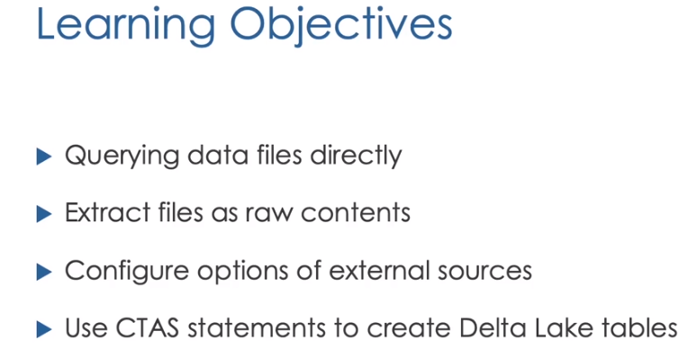

Extract, load, and transform (ELT) is a natural pattern for the lakehouse. Data is first loaded into inexpensive, scalable storage and is then transformed with the distributed processing capabilities of Apache Spark. In Databricks, Spark SQL and Python can be used together to inspect source files, create Delta tables, update records, and reshape nested data for analytics.

This walkthrough follows the complete bookstore exercise from the original notes. The dataset contains three related entities:

- `customers`, supplied as JSON
- `books`, supplied as CSV
- `orders`, supplied as Parquet and containing a nested array of purchased books


_The original notebook starts by querying source files directly before creating tables._

> The examples retain the dataset variables and repository paths from the original training notebook. In a newer workspace, the same ideas can be applied with Unity Catalog volumes and workspace files.

## Querying Files Directly

Spark SQL can query supported files without first registering them as tables. The general syntax is:

```sql
SELECT *
FROM file_format.`/path/to/file`;
```

The path must be enclosed in backticks. It can identify:

- one file
- a group of files through a wildcard
- a directory containing files of the same type and compatible schema

For example:

```sql
SELECT *
FROM json.`${dataset.bookstore}/customers-json/export_001.json`;
```

To query every compatible JSON file in the directory, remove the individual filename:

```sql
SELECT *
FROM json.`${dataset.bookstore}/customers-json`;
```

This works especially well with self-describing formats such as JSON and Parquet because Spark can infer their schemas. Direct file queries are useful for exploration, but the notebook preview displays only the first 1,000 records. A preview should therefore not be treated as proof that the entire source contains only those rows.

CSV files are more difficult to query directly because important parsing details, such as whether a header exists and which delimiter is used, are not stored in the format itself. When file-reader options or a schema must be supplied, create a temporary view or external table instead.

### Reading Raw Text and Binary Files

The `text` data source reads each record as a raw string in a column named `value`:

```sql
SELECT *
FROM text.`/path/to/text/files`;
```

It can be used with JSON, CSV, TSV, and plain-text files when the original content needs to be inspected without normal parsing. This is useful for corrupted records, irregular files, or custom parsing logic.

The `binaryFile` data source reads binary or unstructured files. Its result includes the path, modification time, length, and binary content:

```sql
SELECT *
FROM binaryFile.`/path/to/binary/files`;
```

## Creating Tables with CTAS

`CREATE TABLE AS SELECT`, usually called CTAS, creates a table from the result of a query:

```sql
CREATE TABLE customers AS
SELECT *
FROM json.`${dataset.bookstore}/customers-json`;
```

CTAS automatically derives the table schema from the query result. A separate column declaration is unnecessary. In Databricks, a table created this way uses Delta by default unless another format is specified.

CTAS is a convenient way to copy Parquet or correctly parsed query results into a Delta table. It is less suitable when the source requires extra reader options. A direct CSV query, for example, cannot conveniently declare the header, delimiter, and schema in the CTAS statement.

## Tables Against External Data Sources

The `USING` clause registers a table or view against an external data source. It supports reader options that a direct file query cannot express:

```sql
CREATE TABLE books_external (
  book_id STRING,
  title STRING,
  author STRING,
  category STRING,
  price DOUBLE
)
USING CSV
OPTIONS (
  path = '${dataset.bookstore}/books-csv/export_*.csv',
  header = 'true',
  delimiter = ';'
);
```

An optional `LOCATION` can also point to the source path. Data is not moved when an external table is registered. The table continues to read the original files in their original format, so the example above is a CSV table rather than a Delta table.

This distinction matters. A table backed directly by CSV, JSON, JDBC, or another external source does not gain Delta Lake features merely because it can be queried from the metastore.

### JDBC External Tables

Spark SQL can register a relational database table through JDBC:

```sql
CREATE TABLE users_jdbc
USING JDBC
OPTIONS (
  url = 'jdbc:postgresql://host:5432/database',
  dbtable = 'public.users',
  user = 'username',
  password = 'password'
);
```

The connection options identify the JDBC URL, remote table, username, and password. In a real environment, credentials should be supplied through secrets or a governed connection instead of being written directly in a notebook.

A JDBC-backed table remains an external, non-Delta source. It does not provide Delta time travel or Delta transaction guarantees, and repeatedly scanning a very large remote table can be slow.

### Temporary View Followed by CTAS

A useful pattern is to parse the source through a temporary view and then materialize the parsed result as Delta:

```sql
CREATE TEMP VIEW books_tmp_vw (
  book_id STRING,
  title STRING,
  author STRING,
  category STRING,
  price DOUBLE
)
USING CSV
OPTIONS (
  path = '${dataset.bookstore}/books-csv/export_*.csv',
  header = 'true',
  delimiter = ';'
);
```

```sql
CREATE TABLE books AS
SELECT *
FROM books_tmp_vw;
```

The temporary view handles the CSV-specific schema and options. CTAS then writes its correctly parsed rows into a Delta table.

## Querying Files: Hands-On Lab

The original lab initializes a bookstore dataset with a shared setup notebook:

```python
%run /Repos/babin@azurefusemachines.onmicrosoft.com/Databricks-Certified-Data-Engineer-Associate/Includes/Copy-Datasets
```

The dataset contains customer JSON files, book CSV files, and order Parquet files.

### Inspect the Customer Files with Python

`dbutils.fs.ls` lists the files in the customer directory:

```python
%python
files = dbutils.fs.ls(f"{dataset_bookstore}/customers-json")
display(files)
```

This Python step verifies the available files and their paths before SQL is used to read them.

### Query One JSON File

```sql
SELECT *
FROM json.`${dataset.bookstore}/customers-json/export_001.json`;
```

Spark infers the JSON schema and presents the fields as columns. The same syntax can be used with a wildcard to query a subset of filenames:

```sql
SELECT *
FROM json.`${dataset.bookstore}/customers-json/export_*.json`;
```

### Query the Complete JSON Directory

```sql
SELECT *
FROM json.`${dataset.bookstore}/customers-json`;
```

Spark reads all compatible files from the directory as one relation.

### Create the Customers Delta Table

```sql
CREATE OR REPLACE TABLE customers AS
SELECT *
FROM json.`${dataset.bookstore}/customers-json`;
```

The table schema is inferred from the query and the source records are written into Delta.

### Inspect the Book CSV Files

```python
%python
files = dbutils.fs.ls(f"{dataset_bookstore}/books-csv")
display(files)
```

Unlike JSON, CSV does not carry a complete schema. Reading it without the correct options can treat the header as data, use the wrong separator, or assign every column a generic string type.

### Parse the Books with an Explicit Schema

```sql
CREATE OR REPLACE TEMP VIEW books_tmp_vw (
  book_id STRING,
  title STRING,
  author STRING,
  category STRING,
  price DOUBLE
)
USING CSV
OPTIONS (
  path = '${dataset.bookstore}/books-csv/export_*.csv',
  header = 'true',
  delimiter = ';'
);
```

Validate the parsed records:

```sql
SELECT *
FROM books_tmp_vw;
```

Then create the Delta table:

```sql
CREATE OR REPLACE TABLE books AS
SELECT *
FROM books_tmp_vw;
```

### Create the Orders Table from Parquet

Parquet is self-describing, so it can feed CTAS directly:

```sql
CREATE OR REPLACE TABLE orders AS
SELECT *
FROM parquet.`${dataset.bookstore}/orders`;
```

At this point, all three bookstore entities are available as Delta tables.

## Writing to Delta Tables

Delta tables support ACID transactions. Appends, overwrites, updates, deletes, and merges are committed atomically, which prevents readers from seeing a partially written table.

### INSERT INTO

`INSERT INTO` appends query results to an existing table:

```sql
INSERT INTO orders
SELECT *
FROM parquet.`${dataset.bookstore}/orders-new`;
```

Running the same append repeatedly writes the same rows repeatedly. The operation does not automatically identify duplicates, so the pipeline must determine whether a source record has already been processed.

Rows can also be supplied directly:

```sql
INSERT INTO customers
VALUES ('C9999', 'New Customer', 'new.customer@example.com');
```

The values and their order must be compatible with the target schema.

### INSERT OVERWRITE

`INSERT OVERWRITE` replaces the rows in an existing table with the result of a query:

```sql
INSERT OVERWRITE customers
SELECT *
FROM customers_corrected;
```

It differs from `CREATE OR REPLACE TABLE` in several useful ways:

- it only overwrites an existing table
- it does not create a new table when the target is missing
- the query result must match the current table schema
- the table definition remains in place

Overwriting is safer than manually deleting and recreating the table. The replacement is one atomic transaction, and the earlier version remains in Delta history so it can be queried through time travel.

### UPDATE and DELETE

Delta supports row-level changes:

```sql
UPDATE customers
SET email = 'updated@example.com'
WHERE customer_id = 'C0001';
```

```sql
DELETE FROM customers
WHERE customer_id = 'C0001';
```

These commands are useful for targeted corrections. When a source contains a mixture of new and changed records, `MERGE` is usually more appropriate.

## MERGE INTO

`MERGE` compares a source table, view, or DataFrame with a target Delta table. It can insert, update, and delete rows in one atomic transaction.

```sql
MERGE INTO customers AS c
USING customers_updates AS u
ON c.customer_id = u.customer_id
WHEN MATCHED THEN
  UPDATE SET *
WHEN NOT MATCHED THEN
  INSERT *;
```

The `ON` clause defines how source rows match target rows. Each `WHEN` clause defines an action:

- `WHEN MATCHED` can update or delete an existing target row
- `WHEN NOT MATCHED` can insert a new row
- conditions can be added to make each action more selective

The source should contain at most one row for each target key. If multiple source rows match one target row, the intended update becomes ambiguous.

## Writing to Tables: Hands-On Lab

### Append New Orders

The incoming order files can be appended to the `orders` table:

```sql
INSERT INTO orders
SELECT *
FROM parquet.`${dataset.bookstore}/orders-new`;
```

Querying the table afterward confirms that the new rows have been added. Re-running the cell demonstrates the duplicate risk of a non-idempotent append.

### Build a Customer Update View

The new customer JSON contains both updates to existing customers and entirely new customers:

```sql
CREATE OR REPLACE TEMP VIEW customers_updates AS
SELECT *
FROM json.`${dataset.bookstore}/customers-json-new`;
```

Inspect the staged changes:

```sql
SELECT *
FROM customers_updates;
```

### Merge Customer Changes

```sql
MERGE INTO customers AS c
USING customers_updates AS u
ON c.customer_id = u.customer_id
WHEN MATCHED THEN
  UPDATE SET *
WHEN NOT MATCHED THEN
  INSERT *;
```

Matching customer IDs are updated, including changed email addresses. Customer IDs that do not yet exist are inserted.

### Stage and Merge Book Changes

The book update files are CSV, so they need the same schema and parsing options as the original source:

```sql
CREATE OR REPLACE TEMP VIEW books_updates (
  book_id STRING,
  title STRING,
  author STRING,
  category STRING,
  price DOUBLE
)
USING CSV
OPTIONS (
  path = '${dataset.bookstore}/books-csv-new/export_*.csv',
  header = 'true',
  delimiter = ';'
);
```

```sql
MERGE INTO books AS b
USING books_updates AS u
ON b.book_id = u.book_id
WHEN MATCHED THEN
  UPDATE SET *
WHEN NOT MATCHED THEN
  INSERT *;
```

This applies changed book attributes and inserts new titles without replacing the complete table.

## Working with Nested Data

Spark SQL has first-class support for complex types:

- `STRUCT` groups named fields into one value
- `ARRAY` stores an ordered collection of values
- `MAP` stores key-value pairs

The bookstore `orders` table contains a `books` array. Each element is a struct with details such as `book_id`, `quantity`, and `subtotal`.

### Access Struct Fields

Fields inside a struct can be selected with dot notation:

```sql
SELECT
  order_id,
  books[0].book_id AS first_book_id,
  books[0].quantity AS first_book_quantity
FROM orders;
```

Array indexes begin at zero. Selecting a fixed position is useful for inspection but not for processing every element.

### Explode an Array

`explode` returns one output row for each array element:

```sql
SELECT
  order_id,
  customer_id,
  explode(books) AS book
FROM orders;
```

The resulting `book` column is still a struct. Its fields can be projected in another query:

```sql
SELECT
  order_id,
  customer_id,
  book.book_id,
  book.quantity,
  book.subtotal
FROM (
  SELECT
    order_id,
    customer_id,
    explode(books) AS book
  FROM orders
);
```

This converts the nested order structure into an item-level relation.

### collect_set

`collect_set` aggregates unique values into an array:

```sql
SELECT
  customer_id,
  collect_set(books) AS books_set
FROM orders
GROUP BY customer_id;
```

Because `books` is already an array, `books_set` is an array of arrays.

### flatten

`flatten` removes one level of array nesting:

```sql
SELECT
  customer_id,
  flatten(collect_set(books)) AS books
FROM orders
GROUP BY customer_id;
```

The result is one array of book structs for each customer rather than an array containing separate arrays from each order.

## Joining Bookstore Data

Spark SQL supports the standard join types:

- inner
- left
- right
- full outer
- cross
- left semi
- left anti

After exploding the order items, an inner join can enrich each item with its book title, author, category, and price:

```sql
WITH order_items AS (
  SELECT
    order_id,
    customer_id,
    explode(books) AS book
  FROM orders
)
SELECT
  i.order_id,
  i.customer_id,
  i.book.book_id,
  b.title,
  b.author,
  b.category,
  i.book.quantity,
  i.book.subtotal
FROM order_items AS i
INNER JOIN books AS b
  ON i.book.book_id = b.book_id;
```

The result can also be joined with `customers` on `customer_id` to add customer details.

A left semi join returns only rows from the left side that have a match:

```sql
SELECT c.*
FROM customers AS c
LEFT SEMI JOIN orders AS o
  ON c.customer_id = o.customer_id;
```

A left anti join returns left-side rows without a match:

```sql
SELECT c.*
FROM customers AS c
LEFT ANTI JOIN orders AS o
  ON c.customer_id = o.customer_id;
```

These joins are useful when only existence or non-existence matters and columns from the right side are unnecessary.

## Set Operations

Set operations combine the results of compatible queries. Both sides must return the same number of columns with compatible types.

`UNION` combines results and removes duplicate rows:

```sql
SELECT customer_id
FROM customers
WHERE email LIKE '%.com'
UNION
SELECT customer_id
FROM orders;
```

`UNION ALL` retains duplicates:

```sql
SELECT customer_id FROM customers
UNION ALL
SELECT customer_id FROM orders;
```

`INTERSECT` returns rows that appear in both results:

```sql
SELECT customer_id FROM customers
INTERSECT
SELECT customer_id FROM orders;
```

`MINUS`, also available as `EXCEPT`, returns rows from the first result that are absent from the second:

```sql
SELECT customer_id FROM customers
MINUS
SELECT customer_id FROM orders;
```

The last query identifies customers who have not placed an order.

## Reshaping Results with PIVOT

`PIVOT` turns distinct row values into columns. Its first argument is an aggregation expression. The `FOR` subclause identifies the pivot column, and `IN` lists the values that should become output columns.

The following example reports quantities by selected book IDs:

```sql
WITH order_items AS (
  SELECT
    customer_id,
    book.book_id AS book_id,
    book.quantity AS quantity
  FROM orders
  LATERAL VIEW explode(books) exploded AS book
)
SELECT *
FROM order_items
PIVOT (
  sum(quantity)
  FOR book_id IN ('B01', 'B02', 'B03')
);
```

The same idea can pivot another known category, such as book category, after joining order items to the `books` table.

## Advanced Transformations: Hands-On Lab

The advanced lab brings the previous operations together:

1. Query `orders` and inspect the `books` array of structs.
2. Access one array element and its named struct fields.
3. Use `explode` to produce one row per purchased book.
4. Use `collect_set` to gather each customer's unique order arrays.
5. Use `flatten` to turn the array of arrays into one book array.
6. Join exploded items to `books` for titles, authors, categories, and prices.
7. Join orders to `customers` for customer information.
8. Use semi and anti joins when only matching or non-matching customers are needed.
9. Combine compatible results with `UNION`, `INTERSECT`, and `MINUS`.
10. Pivot an aggregated measure across a known group of values.

The important theme is that nested data can either be preserved and processed as arrays or normalized into rows. The correct choice depends on the next operation.

## Higher-Order Functions

Exploding is not always necessary. Higher-order functions apply expressions directly to elements of an array while preserving the outer row.

### filter

The `filter` function keeps array elements that satisfy a lambda expression. This query retains books for which at least two copies were purchased:

```sql
SELECT
  order_id,
  books,
  filter(books, book -> book.quantity >= 2) AS multiple_copies
FROM orders;
```

Orders with no matching elements receive an empty array. To remove them, calculate the array first and apply `size` in an outer query:

```sql
SELECT *
FROM (
  SELECT
    order_id,
    customer_id,
    filter(books, book -> book.quantity >= 2) AS multiple_copies
  FROM orders
)
WHERE size(multiple_copies) > 0;
```

The subquery is necessary because the `WHERE` clause cannot directly reuse a select-list alias at the same query level.

### transform

`transform` returns a new array by applying an expression to every element. The following calculation applies a ten-percent discount to each book subtotal:

```sql
SELECT
  order_id,
  transform(
    books,
    book -> book.subtotal * 0.90
  ) AS discounted_subtotals
FROM orders;
```

Each input book produces one transformed value, so the result maintains the relationship between the order and its items.

## SQL User-Defined Functions

A SQL UDF packages reusable Spark SQL logic as a named function.

### Build a URL from an Email Address

The first function splits an email address at `@`, takes the domain at array index `1`, and prefixes it with `http://`:

```sql
CREATE OR REPLACE FUNCTION get_url(email STRING)
RETURNS STRING
RETURN concat('http://', split(email, '@')[1]);
```

Use it like a built-in function:

```sql
SELECT
  customer_id,
  email,
  get_url(email) AS website
FROM customers;
```

Unlike a temporary view, a SQL UDF is persisted in the current database or schema. It can be called from other notebooks and sessions that have access to it.

Inspect its definition and metadata:

```sql
DESCRIBE FUNCTION get_url;
```

```sql
DESCRIBE FUNCTION EXTENDED get_url;
```

### Categorize an Email Extension

A second UDF can use `CASE WHEN` and `LIKE` to classify email domains:

```sql
CREATE OR REPLACE FUNCTION site_type(email STRING)
RETURNS STRING
RETURN CASE
  WHEN email LIKE '%.com' THEN 'Commercial'
  WHEN email LIKE '%.org' THEN 'Organization'
  WHEN email LIKE '%.edu' THEN 'Educational'
  ELSE 'Unknown'
END;
```

Apply it to the customer table:

```sql
SELECT
  customer_id,
  email,
  site_type(email) AS site_type
FROM customers;
```

SQL UDFs use Spark SQL expressions and participate in Spark's distributed execution. They are useful when the same business rule appears in many queries, although a built-in function should still be preferred when one already provides the required behavior.

## Higher-Order Functions and UDFs: Hands-On Lab

The final lab again initializes the bookstore dataset and works through these steps:

1. Inspect the `orders.books` array of structs.
2. Use `filter` to retain items with a quantity of two or more.
3. Use a subquery and `size` to exclude empty filtered arrays.
4. Use `transform` to calculate a discounted subtotal for every book.
5. Create `get_url` by splitting the customer's email address.
6. Apply `get_url` to the `customers` table.
7. Inspect the function with both forms of `DESCRIBE FUNCTION`.
8. Create the conditional email-extension classification function.
9. Apply that function to every customer.

## What This ELT Workflow Demonstrates

The complete notebook moves through the main stages of a lakehouse ELT pipeline:

1. Inspect source directories with Python utilities.
2. Query JSON and Parquet directly with Spark SQL.
3. Supply explicit schemas and options for CSV.
4. Materialize correctly parsed data as Delta tables.
5. Append new batches with `INSERT INTO`.
6. Replace table contents transactionally with `INSERT OVERWRITE`.
7. Apply inserts and updates atomically with `MERGE`.
8. Navigate structs and arrays without flattening them prematurely.
9. Use `explode`, `collect_set`, and `flatten` when row-level processing is needed.
10. Enrich and compare datasets with joins and set operations.
11. Reshape aggregates with `PIVOT`.
12. Process arrays in place with `filter` and `transform`.
13. Package repeated SQL logic as persistent UDFs.

Together, these techniques form a practical foundation for transforming raw bookstore files into reliable, queryable Delta tables.

## Source

Based on my Notion notes: [3. ELT with SparkSQL and Python](https://app.notion.com/p/9cd85a41c97d42bbb90b605b790e489e).
