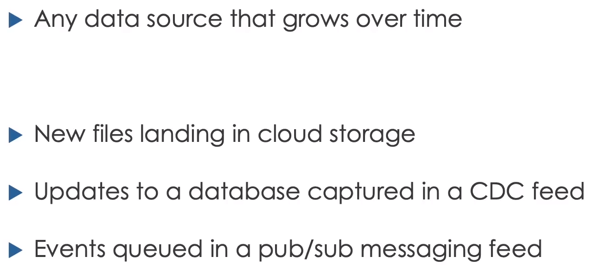

A data stream is any data source that grows over time. It may be a directory receiving files, a Kafka topic, a CDC feed, or a Delta table receiving new commits.

Spark Structured Streaming processes that changing source incrementally using DataFrame and SQL operations.


_Structured Streaming represents an evolving source as an unbounded table_

## Traditional Reprocessing vs Incremental Processing

A batch pipeline can reread the complete dataset whenever new data arrives. This is simple but becomes wasteful as history grows.

Incremental processing tracks progress and handles only new input. It reduces repeated work and supports lower latency.

## The Unbounded Table Model

Structured Streaming treats a stream as an unbounded table. Every arriving event becomes another logical row. The engine evaluates the query repeatedly in micro-batches and writes changes to a sink.

The same transformation concepts apply to static and streaming DataFrames, but not every operation is valid for an infinite input.

## Reading a Stream

```python
orders_stream = (
    spark.readStream
    .format("delta")
    .table("orders_source")
)
```

For files with a fixed schema:

```python
orders_stream = (
    spark.readStream
    .schema(order_schema)
    .format("parquet")
    .load("/Volumes/main/bookstore/incoming/orders")
)
```

Defining a streaming DataFrame does not start processing. Processing begins when a streaming action such as `writeStream` or a streaming display is started.

## Writing a Stream

```python
query = (
    orders_stream.writeStream
    .format("delta")
    .option(
        "checkpointLocation",
        "/Volumes/main/bookstore/checkpoints/orders_bronze"
    )
    .outputMode("append")
    .toTable("orders_bronze")
)
```

## Checkpoints

A checkpoint stores:

- Source offsets
- Query progress
- Commit information
- Stateful operator data where required

This allows a failed query to resume.

Every independent streaming write needs a unique checkpoint. Reusing one checkpoint for different queries can produce incorrect progress or failure.

## Trigger Modes

### Default

Runs micro-batches as quickly as the system can process them.

### Fixed Interval

```python
.trigger(processingTime="2 minutes")
```

Checks for new data at the configured interval.

### Available Now

```python
.trigger(availableNow=True)
```

Processes all currently available data in one or more micro-batches and then stops. This is well suited to scheduled incremental jobs.

The older `once` trigger processes available data in a single batch, but `availableNow` is generally more scalable.

## Output Modes

- **Append** writes new finalized rows.
- **Update** writes result rows changed since the previous trigger.
- **Complete** rewrites the complete result for supported aggregations.

The valid mode depends on the query. Complete mode is commonly used for an aggregate gold result, while append mode fits immutable bronze ingestion.

## Exactly-Once Semantics

Structured Streaming uses repeatable source offsets, checkpoints, write-ahead information, and compatible sinks to provide strong guarantees.

End-to-end exactly-once behavior requires:

- A replayable source
- Deterministic processing where possible
- A sink that handles retries idempotently
- Careful handling of external side effects

Writing to an external API in `foreachBatch` does not become exactly-once automatically.

## Streaming Limitations

An unbounded table has no final last row, so some operations need additional information or are unsupported.

Examples requiring care include:

- Global sorting
- Deduplication without a bounded state strategy
- Arbitrary stream-stream joins
- Aggregations without event-time bounds
- Reading a table as a stream after incompatible updates

Advanced stateful processing uses event time, windows, and watermarks to control how long Spark retains state.

## Windowing and Watermarks

Window event-time data:

```python
from pyspark.sql import functions as F

counts = (
    events
    .withWatermark("event_time", "10 minutes")
    .groupBy(F.window("event_time", "5 minutes"))
    .count()
)
```

The watermark tells Spark how late data may arrive before old state can be removed. It is a state-management boundary, not a guarantee that every late record is accepted.

## Auto Loader

Auto Loader incrementally ingests files using `cloudFiles`:

```python
orders_raw = (
    spark.readStream
    .format("cloudFiles")
    .option("cloudFiles.format", "parquet")
    .option(
        "cloudFiles.schemaLocation",
        "/Volumes/main/bookstore/schemas/orders"
    )
    .load("/Volumes/main/bookstore/incoming/orders")
)
```

Auto Loader can scale to very large file counts and tracks discovered files efficiently.

## Schema Inference and Evolution

Auto Loader can infer a schema and store it at `cloudFiles.schemaLocation`. Production pipelines should explicitly decide:

- Whether new columns are allowed
- Whether types may change
- Where malformed data goes
- Whether schema changes stop the pipeline

Unexpected fields can be captured in a rescued-data column when configured, allowing the valid portion of a record to continue through ingestion while preserving unparsed content for analysis.

## Auto Loader with SQL

Declarative SQL pipelines can use `cloud_files`:

```sql
SELECT *
FROM cloud_files(
  '/Volumes/main/bookstore/incoming/orders',
  'parquet'
);
```

The pipeline manages incremental progress and table dependencies.

## Medallion Architecture

The multi-hop, or medallion, architecture divides data into bronze, silver, and gold layers.

### Bronze

Bronze preserves source data and ingestion metadata:

```python
bronze = (
    orders_raw
    .withColumn("arrival_time", F.current_timestamp())
    .withColumn("source_file", F.input_file_name())
)
```

Write it with a dedicated checkpoint.

### Silver

Silver validates and enriches data:

```sql
SELECT
  o.order_id,
  o.customer_id,
  c.profile:first_name::STRING AS first_name,
  c.profile:last_name::STRING AS last_name,
  CAST(from_unixtime(o.order_timestamp) AS TIMESTAMP) AS order_timestamp,
  o.quantity,
  o.books
FROM orders_bronze_stream o
INNER JOIN customers_lookup c
  ON o.customer_id = c.customer_id
WHERE o.quantity > 0;
```

This is a stream-static join: streaming orders are enriched with a static customer lookup.

### Gold

Gold publishes business aggregates:

```sql
SELECT
  customer_id,
  first_name,
  last_name,
  date_trunc('DAY', order_timestamp) AS order_date,
  sum(quantity) AS books_count
FROM orders_silver_stream
GROUP BY
  customer_id,
  first_name,
  last_name,
  date_trunc('DAY', order_timestamp);
```

The course lab writes this aggregate in complete mode using `availableNow`.

## Hands-On Flow

1. Copy the bookstore dataset.
2. Start with three order files containing 1,000 rows each.
3. Read them through Auto Loader.
4. Add arrival time and source filename.
5. Write 3,000 bronze rows.
6. Land another file and confirm the count becomes 4,000.
7. Build a static customer lookup.
8. Read bronze as a stream.
9. Join, clean, and write silver.
10. Land another file and confirm 5,000 silver rows.
11. Read silver as a stream.
12. Aggregate daily books per customer into gold.
13. Use `availableNow` so the gold update stops after current data is processed.
14. Stop any continuously active streams at the end of the lab.

## Operational Guidance

- Keep each checkpoint unique and durable.
- Track source file and ingestion time.
- Monitor batch duration and processing rate.
- Test restart behavior.
- Set a schema-change policy.
- Bound state with watermarks when needed.
- Make external writes idempotent.
- Do not delete checkpoints merely to make a failed stream start.

## Source Notes

Based on my complete Notion module: [4. Incremental Data Processing](https://app.notion.com/p/05774d28716e4abbb27f27e32089369e).

