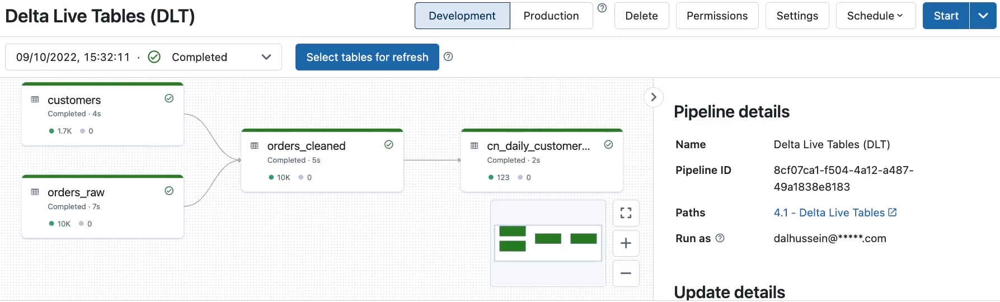

A production data platform needs reliable dependencies, quality controls, source control, orchestration, monitoring, SQL serving, dashboards, and alerts.

The original module uses **Delta Live Tables (DLT)** and **Databricks Repos**. Current Databricks terminology is **Lakeflow Declarative Pipelines** and **Git folders**, although older names remain important when reading existing code and course material.


_The pipeline graph exposes dependencies across bronze, silver, and gold datasets_

## Declarative Pipelines

A declarative pipeline defines the desired datasets and transformations. Databricks derives a dependency graph and manages execution order.

The bookstore example contains:

- `orders_raw` bronze streaming table
- `customers` bronze table
- `orders_cleaned` silver table
- `daily_customer_books` gold table

## SQL Pipeline Definitions

Older DLT SQL uses `LIVE` and `STREAM`:

```sql
CREATE OR REFRESH STREAMING LIVE TABLE orders_raw
COMMENT "Raw orders ingested incrementally"
AS
SELECT *
FROM cloud_files(
  '${dataset_path}/orders',
  'parquet'
);
```

A customer lookup can be defined as another live table:

```sql
CREATE OR REFRESH LIVE TABLE customers
AS
SELECT *
FROM json.`${dataset_path}/customers-json`;
```

Downstream tables refer to pipeline-managed dependencies rather than manually scheduling notebooks in order.

## Data Quality Expectations

```sql
CREATE OR REFRESH STREAMING LIVE TABLE orders_cleaned (
  CONSTRAINT valid_order_id EXPECT (order_id IS NOT NULL) ON VIOLATION DROP ROW
)
AS
SELECT ...
FROM STREAM(LIVE.orders_raw) o
JOIN LIVE.customers c
  ON o.customer_id = c.customer_id;
```

Expectation policies include:

- Retain invalid rows and record metrics
- Drop invalid rows
- Fail the update

Use failure for non-negotiable contracts, dropping for understood invalid records, and metric-only rules while profiling a new source.

## Creating the Pipeline

The course workflow configures:

1. Pipeline name
2. Source notebook
3. `dataset_path` configuration value
4. Storage location for pipeline state and logs
5. Target catalog and schema
6. Triggered or continuous execution
7. Development or production mode
8. Compute settings

Triggered pipelines process available data and stop. Continuous pipelines remain running for lower latency.

Development mode favors faster iteration and relaxed retries. Production mode uses operational settings intended for stable workloads.

## Running and Monitoring

The pipeline graph shows:

- Dataset dependencies
- Update state
- Row and quality metrics
- Errors
- Execution details

Selecting a table reveals expectation results and whether records were retained or dropped.

The event log provides detailed operational records. It can be queried for update duration, quality metrics, failures, and lineage events.

## Full Refresh

A normal update processes new data incrementally. A full refresh rebuilds pipeline datasets.

Use full refresh after a historical logic correction or incompatible state change. Avoid using it as a routine fix because it increases cost and processing impact.

## Databricks Workflows

Workflows schedules and coordinates tasks such as:

- Notebook tasks
- Python scripts
- SQL tasks
- Declarative pipelines
- JAR applications
- dbt tasks

## Creating a Multi-Task Job

The bookstore job can use:

```text
ingest_new_files -> update_pipeline -> refresh_reporting
```

For each task configure:

- Task key and description
- Task type
- Source notebook, script, query, or pipeline
- Compute
- Parameters
- Dependencies
- Retry policy
- Timeout

The dependency graph determines order. If task B depends on task A, A must complete successfully before B starts.

## Scheduling and Notifications

Jobs may run:

- Manually
- On a schedule
- From a file-arrival trigger
- Through the API

Operational settings include maximum concurrent runs, retries, timeouts, and notifications for start, success, failure, or duration warnings.

The Runs tab separates active and completed runs. Open a failed task to inspect notebook output, logs, metrics, and error details.

## Job Compute and Interactive Compute

Use all-purpose compute for exploration and collaborative development. Use job compute or serverless job resources for production automation when possible.

Job compute provides:

- Isolated configuration
- Automatic lifecycle
- Cleaner dependency control
- Reduced interference from interactive users

Cluster pools can reduce classic compute startup time by keeping instances ready.

## Git Folders

Git folders connect workspace code to a remote Git repository.

A common workflow is:

1. Clone the repository.
2. Create or select a branch.
3. Pull remote changes.
4. Edit notebooks or files.
5. Commit local changes.
6. Push the branch.
7. Open a pull request in the Git provider.

Git provides branching and collaboration beyond notebook revision history.

Do not commit credentials, personal access tokens, connection passwords, or environment-specific secrets.

## Databricks SQL

Databricks SQL provides a data-warehouse experience over lakehouse data.

It includes:

- SQL editor
- SQL warehouses
- Query history
- Saved queries
- Visualizations
- Dashboards
- Alerts

## SQL Warehouses

A SQL warehouse supplies compute for queries and dashboards.

Important settings:

- Size
- Minimum and maximum clusters
- Auto stop
- Serverless or classic mode
- Permissions

Scale up when an individual query needs more resources. Scale out when concurrent users need more query capacity.

## Writing and Saving Queries

```sql
SELECT
  pickup_zip,
  sum(fare_amount) AS total_fare
FROM samples.nyctaxi.trips
GROUP BY pickup_zip
ORDER BY total_fare DESC;
```

Save the query so it can feed visualizations, dashboards, schedules, and alerts.

## Visualizations and Dashboards

Query results can become tables, bars, lines, maps, counters, and other visualizations.

A dashboard can combine multiple saved-query results. In edit mode, visualizations can be moved and resized.

Dashboard sharing should consider:

- Who may view it
- Who may run underlying queries
- Whether it runs as viewer or owner
- Whether users have access to the underlying data

## Refresh Schedules

Queries and dashboards can refresh automatically. Match refresh frequency to the business requirement because every refresh consumes warehouse resources.

Use auto stop to reduce idle time, but remember that a stopped warehouse may introduce startup latency.

## Alerts

An alert evaluates a query result:

```sql
SELECT max(total_fare) AS highest_total_fare
FROM fare_by_zip;
```

It can trigger when a value exceeds a threshold and notify email, Slack, Microsoft Teams, or another configured destination.

Good production alerts include:

- Pipeline failure
- Freshness delay
- Null-count threshold
- Unexpected volume change
- Long-running job
- SQL result outside an expected range

## Production Checklist

1. Keep code in Git.
2. Use pull requests and review.
3. Parameterize catalogs, schemas, and paths.
4. Use service principals for automation.
5. Separate development and production.
6. Configure retries and timeouts.
7. Add quality expectations.
8. Monitor pipeline event logs and job runs.
9. Configure alerts and notifications.
10. Test reruns, failure recovery, and full-refresh procedures.

## Source Notes

Based on my complete Notion module: [5. Production Pipelines](https://app.notion.com/p/8ab88adf005743758e908eccc0f081c0).

