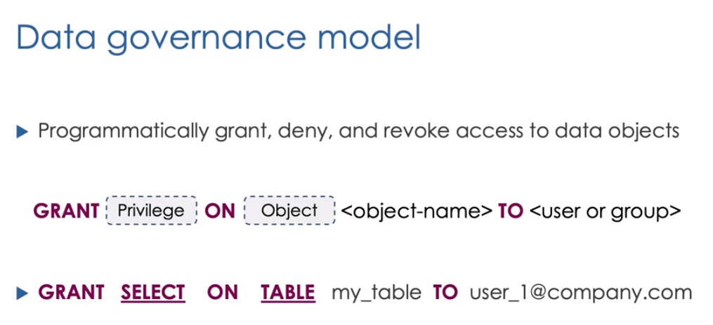

Data governance determines what assets exist, who can discover them, who can access them, what operations are allowed, where data is stored, and how it moves through the platform.

This module begins with the legacy workspace-local Hive metastore privilege model and then develops the centralized Unity Catalog model.


_Permissions connect principals, privileges, ownership, and securable objects_

## Data Objects

Governed objects include:

- Catalogs
- Schemas
- Tables
- Views
- Functions
- Volumes
- External locations
- Storage credentials
- Models and other AI assets

Older Hive metastore materials may also discuss `ANY FILE`, which grants broad file-system access. Modern Unity Catalog designs should prefer governed external locations and volumes.

## Legacy Hive Metastore Privileges

The Hive metastore is local to a workspace. Typical legacy privileges include:

- `SELECT`
- `MODIFY`
- `CREATE`
- `READ_METADATA`
- `USAGE`
- `ALL PRIVILEGES`

Example from the original lab:

```sql
GRANT SELECT, MODIFY, READ_METADATA, CREATE
ON SCHEMA hr_db
TO `hr_team`;

GRANT USAGE
ON SCHEMA hr_db
TO `hr_team`;
```

Grant access to a view:

```sql
GRANT SELECT
ON VIEW hr_db.paris_employees_vw
TO `adam@mycompany.com`;
```

Review permissions:

```sql
SHOW GRANTS ON SCHEMA hr_db;
SHOW GRANTS ON VIEW hr_db.paris_employees_vw;
```

Privileges can be granted, revoked, and, in the legacy model, denied. Ownership controls who can manage permissions on an object.

## Hands-On HR Example

```sql
CREATE SCHEMA IF NOT EXISTS hr_db;

CREATE TABLE hr_db.employees (
  id INT,
  name STRING,
  salary DOUBLE,
  city STRING
);

INSERT INTO hr_db.employees VALUES
  (1, 'Adam', 3500, 'Paris'),
  (2, 'Sarah', 4200, 'London'),
  (3, 'Kim', 5100, 'Paris');

CREATE VIEW hr_db.paris_employees_vw AS
SELECT id, name, salary
FROM hr_db.employees
WHERE city = 'Paris';
```

This demonstrates why a view can be a governed interface: a user may query the Paris view without receiving unrestricted access to every row or column in the base table.

## Why Unity Catalog?

Workspace-local governance becomes difficult when an organization has many workspaces. Unity Catalog centralizes governance across those workspaces.

It provides:

- Central identities and groups
- Central privileges
- Cross-workspace catalogs
- Governed storage access
- Search and discovery
- Automated lineage
- Auditing
- Delta Sharing

## Unity Catalog Hierarchy

```text
metastore
  catalog
    schema
      table, view, volume, function, model
```

### Metastore

The metastore is the top-level regional governance container. It contains metadata and permissions and can be assigned to one or more workspaces.

### Catalog

A catalog is the first part of the three-level namespace. Catalogs commonly separate environments, business units, or data domains.

### Schema

A schema, also called a database, organizes related objects within a catalog.

### Object

Tables, views, volumes, and functions form the third name component:

```sql
SELECT *
FROM production.hr.employees;
```

## Hive Metastore Alongside Unity Catalog

Enabling Unity Catalog does not make the workspace Hive metastore disappear. It remains available through:

```text
hive_metastore.schema.table
```

This supports gradual migration, but new governed workloads should use Unity Catalog unless a specific compatibility requirement prevents it.

## Principals

Unity Catalog grants privileges to:

- Users
- Service principals
- Groups

Users represent people. Service principals represent automated applications. Groups collect users and service principals and may be nested.

Prefer group grants over individual grants because teams change more frequently than access policies.

## Account and Workspace Identities

Unity Catalog uses account-level identities. Identity federation allows the same account-level users, groups, and service principals to be assigned to multiple workspaces.

This avoids maintaining separate copies of identities in every workspace.

## Ownership

Every securable object has an owner. Owners can generally manage the object and delegate access.

For maintainability, production ownership is often assigned to a managed group rather than one employee.

## Unity Catalog Privileges

Common privileges include:

- `USE CATALOG`
- `USE SCHEMA`
- `SELECT`
- `MODIFY`
- `CREATE TABLE`
- `CREATE VIEW`
- `EXECUTE`
- `READ VOLUME`
- `WRITE VOLUME`
- `READ FILES`
- `WRITE FILES`

Read access to a table normally requires parent usage privileges:

```sql
GRANT USE CATALOG
ON CATALOG production
TO `data_analysts`;

GRANT USE SCHEMA
ON SCHEMA production.sales
TO `data_analysts`;

GRANT SELECT
ON TABLE production.sales.orders
TO `data_analysts`;
```

Unity Catalog grants are additive. Use least privilege rather than granting broad management rights for convenience.

## Storage Credentials

A storage credential represents the cloud identity Databricks uses to access storage.

Depending on the cloud, it may use:

- AWS IAM roles
- Azure managed identities or service principals
- Google Cloud service accounts

Notebook users should not need to embed cloud credentials.

## External Locations

An external location combines a cloud path with a storage credential. It allows administrators to govern access to a directory in cloud storage.

External tables and external volumes can then be created under that governed location.

## Volumes

Volumes provide governed access to non-tabular files:

```text
/Volumes/catalog/schema/volume/
```

Use volumes for:

- Raw CSV or JSON files
- Configuration files
- Libraries
- Images
- Model artifacts
- Checkpoints where appropriate

## Managed and External Tables

Managed tables use storage controlled by Unity Catalog. External tables point to data managed separately.

Use managed tables for the simplest governed lifecycle. Use external tables when data must remain independently managed or shared with other systems.

## Search and Discovery

Catalog Explorer exposes:

- Object names and hierarchy
- Schemas and column types
- Comments and descriptions
- Owners
- Permissions
- Data samples where allowed
- Lineage

Good governance includes documentation. A technically secured table with no description or owner is still difficult to use responsibly.

## Lineage

Unity Catalog captures relationships among supported tables, notebooks, jobs, pipelines, queries, and dashboards.

Lineage helps answer:

- Where did this data originate?
- Which pipeline created this table?
- Which dashboards depend on this column?
- What could break if the schema changes?

## Delta Sharing

Delta Sharing allows governed data sharing with recipients.

A **share** is a collection of data assets. A **recipient** is the party receiving access.

Sharing avoids distributing uncontrolled file copies and can support recipients outside the Databricks account.

## Least-Privilege Design

Example roles:

| Role | Typical access |
|---|---|
| Analyst | Use catalog/schema and select curated tables |
| Data engineer | Read sources and modify owned pipeline targets |
| Pipeline service principal | Exact source and target permissions required by automation |
| Data steward | Ownership or management rights for a domain |
| Platform administrator | Metastore, workspace, and identity administration |

## Governance Checklist

1. Design catalogs around meaningful boundaries.
2. Use account-level groups.
3. Use service principals for jobs.
4. Grant parent usage plus object-level privileges.
5. Avoid `ALL PRIVILEGES` unless full administration is required.
6. Use storage credentials and external locations.
7. Prefer volumes over unmanaged file paths.
8. Assign durable group ownership.
9. Add comments and classifications.
10. Review lineage and audit data before breaking changes.

## Source Notes

Based on my complete Notion module: [6. Data Governance](https://app.notion.com/p/3578a45f4f2d478f92abd9c7d435332c).

